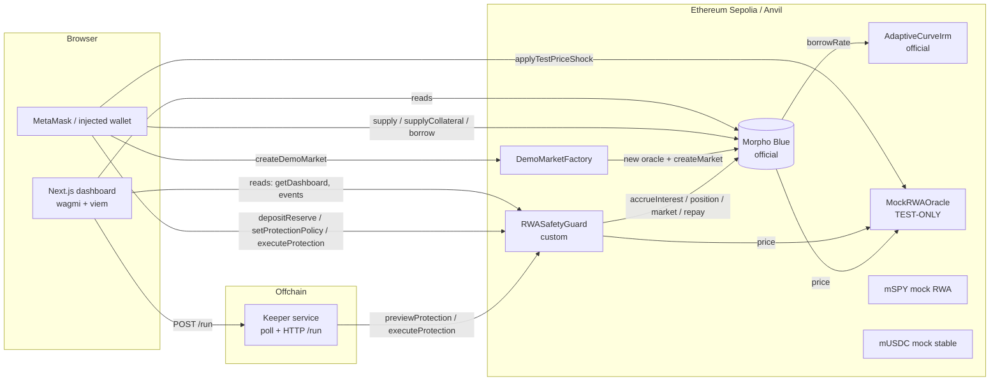

# Architecture

## Components



| Layer | Path | Responsibility |
|---|---|---|
| Protection contract | `contracts/src/RWASafetyGuard.sol` | Policies, per-(user, market) reserves, on-chain risk math, triggered repayment through `Morpho.repay`, events, keeper registry |
| Test assets | `contracts/src/mocks/*` | `mSPY` (18 dec) and `mUSDC` (6 dec) with rate-limited faucets; Morpho-compatible `MockRWAOracle` |
| Demo helper | `contracts/src/demo/DemoMarketFactory.sol` | Deploys a caller-owned test oracle and calls `Morpho.createMarket` (verifies IRM/LLTV are enabled first) |
| Keeper | `services/keeper` | Reads the registry, previews each position, simulates then sends `executeProtection`, waits for receipts, logs hashes; HTTP API for manual triggers |
| Shared | `packages/shared` | Generated ABIs + deployments, chain config, bigint mirror of the protection math (simulator), formatting |
| Dashboard | `apps/web` | Position overview, LTV meter, protection engine, settings, simulator (Recharts), guided demo, event history |

## Why a per-user demo market?

Morpho markets are identified by `keccak256(loanToken, collateralToken, oracle, irm, lltv)`. A shared market with a
shared test oracle would let one demo user's "crash" hit everyone. `DemoMarketFactory.createDemoMarket` deploys a fresh
`MockRWAOracle` whose `PRICE_UPDATER_ROLE` belongs to the caller, so each wallet gets an isolated market on the **real**
Morpho contract. The factory holds no funds or roles. A shared default market (oracle owned by the deployer, seeded with
100k mUSDC liquidity) is also created at deployment.

## Oracle scaling

Morpho's `IOracle.price()` is the price of **one collateral unit in loan-token units, scaled by 1e36**:

```
price() = P_e8 × 10^(36 + loanDecimals − collateralDecimals − 8)
mSPY (18) / mUSDC (6) at $500:  500e8 × 10^16 = 5e26
4 mSPY → 4e18 × 5e26 / 1e36 = 2,000e6 mUSDC units = $2,000
```

`MockRWAOracleTest.test_MorphoBorrowLimitConfirmsOracleScale` proves it with Morpho itself: with $2,000 collateral
and LLTV 77%, exactly 1,540 mUSDC can be borrowed and 1,540.000001 reverts with `insufficient collateral`.
A fuzz test checks the scale for collateral/loan decimals 0–24. Invalid prices (0, < $0.01, > $1M, shocks of 0 or
> 99%) are rejected, and every function is named `setTestPrice` / `applyTestPriceShock` / `resetTestPrice` with
`IS_TEST_ORACLE = true` and a `DESCRIPTION` stating it is not market data.

## Protection math (on-chain)

All amounts are in loan-token units, LTVs in WAD (1e18 = 100%).

| Quantity | Formula | Rounding |
|---|---|---|
| Debt | `borrowShares × (totalBorrowAssets + 1) / (totalBorrowShares + 1e6)` | up — identical to Morpho's `_isHealthy` |
| Collateral value | `collateral × price / 1e36` | down |
| LTV | `debt × 1e18 / collateralValue` (∞ if value is 0) | up (conservative) |
| Target debt | `collateralValue × targetLtv / 1e18` | down |
| Required repayment | `min(debt, debt − targetDebt + ⌈1 share in assets⌉ + 1)` | margin covers `Morpho.repay`'s `toSharesDown` |
| Repayment | `min(required, reserve, maxRepayPerExecution)` | — |
| Liquidation price | `⌈debt / lltv⌉ × 1e36 / collateral` | up |
| Price drop to liquidation | `1 − ltv / lltv` | — |

The margin derivation: `Morpho.repay(assets)` burns `s = ⌊assets × S/A⌋` shares; the remaining debt rounded up is at
most `debt − assets + ⌈A/S⌉`. Over-repaying by `⌈A/S⌉ + 1` therefore guarantees `debtAfter < targetDebt`, i.e.
`ltvAfter ≤ target`. The fuzz test `testFuzz_ExecutionInvariants` asserts this for arbitrary collateral, LTVs,
crashes, reserves and up to a year of accrued interest, and that the view preview equals the execution to the wei.

### Execution sequence

```mermaid
sequenceDiagram
  participant K as Keeper (or anyone)
  participant G as RWASafetyGuard
  participant M as Morpho Blue
  participant O as Market oracle
  K->>G: executeProtection(marketParams, user)
  G->>G: policy enabled? cooldown elapsed?
  G->>M: accrueInterest(marketParams)
  G->>M: position(id, user), market(id)
  G->>O: price()  (revert if 0)
  G->>G: LTV ≥ trigger? compute repay = min(required, reserve, cap)
  G->>G: reserve -= repay, lastExecutedAt = now   (effects first)
  G->>G: forceApprove(Morpho, repay)
  G->>M: repay(marketParams, repay | shares, onBehalf = user)
  M->>G: transferFrom(guard → Morpho, repay)
  G->>G: assert repaid == planned, reset allowance
  G->>M: position(id, user), market(id)  (re-read)
  G->>G: require debtAfter < debtBefore
  G-->>K: emit ProtectionExecuted(…, ltvBefore, ltvAfter, reserveAfter, targetReached)
```



## Keeper

```
loop every KEEPER_POLL_INTERVAL_MS (exponential backoff on RPC errors, max 5 min):
  positions = guard.getProtectedPositions(offset, pageSize)   # paginated registry
  for each (user, marketId):
     params = morpho.idToMarketParams(marketId)               # cached
     preview = guard.previewProtection(params, user)
     if preview.executable:
        simulateContract(executeProtection)                   # skips races without spending gas
        writeContract → hash (logged) → waitForTransactionReceipt
        decode ProtectionExecuted → history
```

- **No duplicate concurrent execution:** ticks are serialized by a promise mutex (a manual `POST /run` during a poll
  waits), plus a per-position in-flight set; transactions are sent sequentially (no nonce races). On-chain, a second
  call reverts `PositionHealthy`/`CooldownActive`, so even two independent keepers cannot double-spend a reserve.
- **Failure handling:** RPC errors fail the tick and back off; one broken market (e.g. reverting oracle) is skipped
  without blocking others; reverted receipts and decoded custom errors are logged.
- **HTTP:** `GET /health`, `GET /status`, `POST /run {user?, marketId?}` (rate-limited, CORS allow-list).
- **Disclosure:** automation depends on the keeper being online and its transaction being included; the dashboard
  states this next to the controls.

## Dashboard data flow

- `getDashboard(market, user)` returns `(PositionRisk, ProtectionPolicy, ProtectionPreview)` in one call; balances,
  allowances, oracle state and Morpho market totals are separate reads, batched into one JSON-RPC request per refresh.
- Writes: `simulateContract → writeContract → waitForTransactionReceipt`, exact-amount approvals, toasts with
  Etherscan links, query invalidation.
- History: chunked `eth_getLogs` over guard, Morpho, faucets, factory and the market oracle, decoded with the ABIs,
  filtered to the wallet + selected market, with block timestamps; plus wallet-side entries (approvals, pending, failed).
- Simulator: bigint mirror of the contract math (`packages/shared/src/risk.ts`), clearly labeled as simulated, with a
  read-only `previewProtectionAtPrice` cross-check keyed on the live position.
